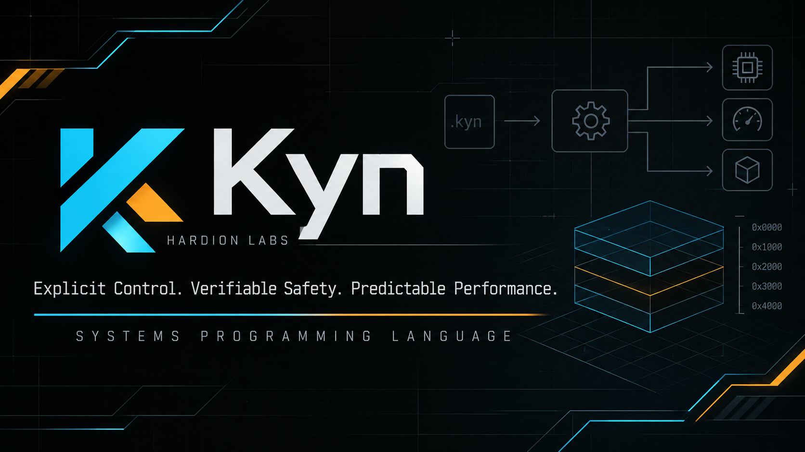

<p align="center">
  
</p>
<div align="center">

# ⚡ Kyn

### **Explicit Control. Verifiable Safety. Predictable Performance.**

*A systems programming language for kernels, drivers, embedded systems, runtimes, and high-performance native software.*

[](LICENSE)
[](#-current-limitations)
[](#)
[](https://ziglang.org)
[](https://github.com/Hardion-Labs/Kyn/pulls)

---

> 🧪 **Status:** `v0.1.0-alpha.5` — *published preview, actively developed.*  
> See the [release](https://github.com/Hardion-Labs/Kyn/releases/tag/v0.1.0-alpha.5).  
> Features listed under [Current Limitations](#-current-limitations) are **not implemented**.

</div>

---

## 📑 Table of Contents

- [Philosophy](#-philosophy)
- [Quick Start](#-quick-start)
- [A First Look](#-a-first-look)
- [Toolchain](#-toolchain)
- [Safety Profiles](#-safety-profiles)
- [Current Limitations](#-current-limitations)
- [Documentation](#-documentation)
- [Building & Testing](#-building--testing)
- [Repository Layout](#-repository-layout)
- [Roadmap](#-roadmap)
- [License](#-license)

---

## 🎯 Philosophy

Kyn favors **explicitness over inference**, **provable correctness over convenience**, and **predictable code generation over hidden runtime machinery**.

| Principle | What it means |
|:---|:---|
| 🎛️ **Explicit Control** | Allocation, pointers, mutability and conversions are written in the source. No hidden allocations or control flow. |
| 🛡️ **Verifiable Safety** | Compile-time checks for what can be proven. Runtime checks, when added, will **never** be silently removed. |
| ⚙️ **Predictable Performance** | No GC, no ownership inference, no implicit reference counting. Source carries predictable machine costs. |

---

## 🚀 Quick Start

### Requirements

| Tool | Version |
|:---|:---|
| **Zig** | `0.17.0` |
| **Clang** | Recent, with opaque-pointer LLVM IR support |
| **ar + POSIX shell** | Available on PATH |

### Install & Build

```bash
git clone https://github.com/Hardion-Labs/Kyn.git
cd Kyn
zig build
```

### Install from a release archive

Prebuilt toolchain archives are produced by [`packaging/make-dist.sh`](packaging/README.md):

```bash
# Linux
tar -xzf kyn-0.1.0-alpha.5-linux-x86_64.tar.gz
cd kyn-0.1.0-alpha.5-linux-x86_64 && ./install.sh   # /usr/local as root, else ~/.local

# Windows (PowerShell)
Expand-Archive kyn-0.1.0-alpha.5-windows-x86_64.zip -DestinationPath .
cd kyn-0.1.0-alpha.5-windows-x86_64; .\install.ps1
```

Both installers copy `kync` and `kyn-build` to a `bin` directory, put it on
your `PATH` (Windows, user scope), verify the installed binaries with
`--version`, and support uninstalling. See
[`packaging/INSTALL.md`](packaging/INSTALL.md) for requirements (Linux: clang
for `kync build`/`run`; Windows: native build path is not part of the tested
release surface) and manual installation.

### Try It

```bash
# Run an example
./zig-out/bin/kync run examples/hello.kyn

# Type-check only
./zig-out/bin/kync check examples/hello.kyn

# Build a native binary (keeps generated artifacts outside the repo)
./zig-out/bin/kync build examples/hello.kyn -o /tmp/kyn-hello --profile safe
/tmp/kyn-hello
```

---

## 👀 A First Look

```kyn
extern fn puts(s: *const u8) i32;

struct Point {
    x: i32,
    y: i32,
}

fn sum(p: *Point) i32 {
    return p->x + p->y;
}

fn main() i32 {
    var p: Point = Point { x: 10, y: 20 };
    let q: *Point = &p;
    q->x += 5;
    puts("explicit, checked, native");
    return sum(q) - 30;
}
```

### Design choices visible here

- `let` is immutable; `var` is mutable.
- Pointers are always explicit: `*T` and `*const T`.
- Field access through pointers uses `->`; field access on values uses `.`.
- Conditions must be `bool`.
- Numeric conversions require `as`.
- Files compose through deterministic relative imports. Optional aliases enable
  qualified references; each file has its own top-level namespace, while
  unaliased imports open public names transitively and diagnose ambiguity.
  `private` declarations are enforced.
- Kyn and C can call each other through the C ABI on `x86_64` Linux: scalar types, supported integer-class aggregates (including float/integer fields merged within one eightbyte), one-field `f32`/`f64` structs as scalar SSE values, two-adjacent-`f32` structs as `<2 x float>` SSE/SSEUP values, three-adjacent-`f32` structs as `<2 x float>, float`, four-adjacent-`f32` structs as `<2 x float>, <2 x float>`, two-direct-`f64` structs in two SSE argument registers, direct `{ f32, f64 }` and `{ f64, f32 }` structs in their two SSE argument registers, direct `{ f32, i64 }` / `{ f32, u64 }` and `{ f64, i64 }` / `{ f64, u64 }` structs in one SSE and one INTEGER argument register, direct `{ i8/u8, f64 }` / `{ i16/u16, f64 }` and the reverse `{ f64, i8/u8 }` / `{ f64, i16/u16 }` structs in one exact-width INTEGER and one SSE argument register, direct `{ bool, f64 }` and `{ f64, bool }` structs in one `i8` and one SSE argument register, direct singleton `enum`-member structs with `i8`/`i16`/`i32`/`i64` backings in one exact-width INTEGER and one SSE argument register, aggregates with two or more smaller-INTEGER members packed into one eightbyte followed by a single `f32`/`f64` in one `i64` and one SSE argument register, singleton `i8`/`i16`/`i32`/`i64` aggregates in one exact-width INTEGER argument register, exact multi-member `SSE`/`INTEGER`-split layouts such as `{ f32, f32, i32 }`, `{ f32, f32, i64 }`, `{ i32, f32, f32 }`, `{ f64, f32, f32 }`, the reverse `{ f32, f32, f64 }` and `{ f32, i32, f32, f32 }` layouts, and sub-32-bit or `bool` integer members inside merged `INTEGER` eightbytes, direct `{ f64, i32 }` and `{ i32, f64 }` structs in their SSE/INTEGER registers, two-eightbyte structs whose registers are decided per leaf — pointer members keep a full-width `ptr` register (`{ *u8, i64 }`, `{ i8, *u8 }`, `{ f32, *u8 }`) and a 12-byte aggregate with a sub-register second leaf transports only that width (`{ f32, f32, i16 }` → `<2 x float>, i16`), larger supported structs via `sret`/`byval`, and slices (`struct { T *ptr; size_t len; }`). Variadics and other unsupported small mixed-class layouts remain unsupported.

---

## 🛠️ Toolchain

### `kync` — Compiler Driver

```bash
kync check <file.kyn>          # Parse + type-check
kync emit-llvm <file.kyn>      # Emit LLVM IR
kync build <file.kyn> -o out   # Build native executable
kync run <file.kyn>            # Build and execute
```

`kync` performs lexing, parsing, name resolution, type checking and static
analysis before emitting LLVM IR. Clang is used to assemble and link that IR;
Kyn semantics are implemented in this repository, not by Clang.

### `kyn-build` — Project System

Supports mixed Kyn + C + Zig projects with content-addressed incremental builds.

```kyn
project "hybrid"

target "hybrid" {
    kind: "exe"
    sources: ["src/main.kyn"]
    c_sources: ["src/math.c"]
    zig_sources: ["zig/math.zig"]
    profile: "safe"
}
```

Example:

```bash
./zig-out/bin/kyn-build --file examples/hybrid/kyn.build
./examples/hybrid/build/hybrid/hybrid
```

---

## 🧬 Safety Profiles

| Profile | Native Optimization | Static Analyzer | Runtime Checks |
|:---:|:---:|:---:|:---:|
| 🔵 `debug` | `-O0 -g` | ✅ Always on | ✅ Always on |
| 🟢 `safe` | `-O2` | ✅ Always on | ✅ Always on |
| 🟡 `release` | `-O3` | ✅ Always on | ✅ Always on |
| 🟠 `fast` | `-O3` | ✅ Always on | ✅ Always on |

> ⚠️ Profiles currently affect native optimization only.  
> No implemented check is removed silently.

---

## ⚠️ Current Limitations

Kyn v0.1 deliberately implements a small, verified core. The following are **available with limits**:

| Limitation | Status |
|:---|:---|
| 🟡 Relative-path imports | Aliases, module namespaces and `private` supported; packages/re-exports pending |
| ✅ Slices (`[]T`, `[]const T`) | `&array as []T`, `slice[a..b]`, `.len`, runtime bounds |
| ❌ Generics or traits | Planned |
| ❌ `defer`, `for`, `switch`/`match`, closures or exceptions | Planned |
| ❌ Variadic extern functions | Planned / C wrapper required |
| ❌ Indirect calls and first-class function values | Planned |
| ✅ Fixed-array dynamic indexes | Bounds-checked at runtime; trap on out-of-range |
| ✅ Integer division and remainder | Zero divisor traps; signed `INT_MIN / -1` traps |
| ✅ Integer arithmetic | `+`, `-`, `*`, unary `-`, shifts and division traps on overflow/out-of-range or zero |
| ❌ Casts remain explicit and unchecked | No range/provenance validation |
| ✅ Null pointer dereference | Exact `null` traps on `*p`, `p->field`, `p[index]` |
| ❌ Invalid non-null pointers | Not checked by design; no ownership/provenance tracking |
| ❌ Runtime checks for raw pointers and arbitrary indexing | No bounds metadata |
| ❌ Standard library and runtime | Planned |

Aggregate by-value support across the C ABI is limited:

- Struct and array parameters/returns inside Kyn: ✅
- Aggregate assignment and copies inside Kyn: ✅
- `INTEGER`-class aggregates ≤16 bytes across `extern`/`export`: ✅ (includes float/integer members merged within one eightbyte; `x86_64` Linux)
- Classification by leaf: the register of each eightbyte follows the scalar leaves it carries (integer at leaf width, pointer as `ptr`, several leaves as packed `i64`, one `f32`/`f64` as that scalar, two `f32` as `<2 x float>`), with nested structs flattened exactly as Clang does: ✅ (`x86_64` Linux)
- Larger supported aggregates via `sret`/`byval`: ✅
- One-field `f32`/`f64` structs via scalar SSE coercion: ✅ (`x86_64` Linux)
- Exactly two direct `f32` fields via one SSE/SSEUP vector: ✅ (`x86_64` Linux)
- Exactly three adjacent direct `f32` fields via `<2 x float>, float`: ✅ (`x86_64` Linux)
- Exactly four adjacent direct `f32` fields via `<2 x float>, <2 x float>`: ✅ (`x86_64` Linux)
- Direct `{ f32, f64 }` / `{ f64, f32 }` at offsets 0/8 via two SSE registers: ✅ (`x86_64` Linux)
- Direct `{ f32, i64 }` / `{ f32, u64 }` and `{ f64, i64 }` / `{ f64, u64 }` at offsets 0/8 via SSE + INTEGER: ✅ (`x86_64` Linux)
- Direct `{ i8/u8, f64 }` / `{ i16/u16, f64 }` and reverse `{ f64, i8/u8 }` / `{ f64, i16/u16 }` at offsets 0/8 via exact-width INTEGER + SSE: ✅ (`x86_64` Linux)
- Direct `{ bool, f64 }` / `{ f64, bool }` via full `i8` + SSE registers: ✅ (`x86_64` Linux)
- Direct singleton `enum` members with `i8`/`i16`/`i32`/`i64` backings via member-width INTEGER + SSE: ✅ (`x86_64` Linux)
- Singleton `i8`/`i16`/`i32`/`i64` aggregate passed as a single `i8`/`i16`/`i32`/`i64` register (exact member width): ✅ (`x86_64` Linux)
- Two or more smaller-INTEGER members packed into one eightbyte followed by a single `f32`/`f64` (only scalar next) as `(i64, float)` or `(i64, double)`: ✅ (`x86_64` Linux)
- Singleton `i8`/`i16`/`i32`/`i64` aggregate passed as a single exact-width register (member-width integer): ✅ (`x86_64` Linux)
- Direct `{ enum:u8, f64 }` / `{ f64, enum:u8 }` and `{ enum:u16, f64 }` / `{ f64, enum:u16 }` via exact-width INTEGER + SSE: ✅ (`x86_64` Linux)
- Multi-member `SSE`/`INTEGER`-split layouts (12/16 bytes): `{ f32, f32, i32 }`, `{ f32, f32, i64 }`, `{ i32, f32, f32 }`, `{ f32, i32, f32 }`, `{ f64, i32, f32 }`, `{ i64, f32, f32 }`, `{ f64, f32, f32 }`, `{ f32, f32, f64 }`, `{ i32, f32, f64 }`, `{ f32, f32, i32, f32 }`, `{ i32, f32, f32, f32 }`: ✅ (`x86_64` Linux)
- Exactly two direct `f64` fields via two SSE registers: ✅ (`x86_64` Linux)
- Direct `{ f64, i32 }` / `{ i32, f64 }` at offsets 0/8 via SSE + INTEGER: ✅ (`x86_64` Linux)
- Pointer members in two-eightbyte aggregates via full-width `ptr` registers, never narrowed to an integer member width: `{ *u8, i64 }`, `{ i8, *u8 }`, `{ *u8, *u8 }`, `{ *u8, f64 }`, `{ f32, *u8 }`, `{ i32, i32, *u8 }` → `i64, ptr`: ✅ (`x86_64` Linux)
- 12-byte aggregates whose second eightbyte holds one sub-register leaf, keeping the `<2 x float>` SSE slot: `{ f32, f32, i16 }`, `{ f32, f32, i8 }`, `{ f32, f32, bool }`, `{ f32, f32, *u8 }` and the mirrored `{ i16, f32, f32 }` / `{ *u8, f32, f32 }` / `{ i32, f32, f32 }`: ✅ (`x86_64` Linux)
- Other unsupported small SSE/mixed-class aggregates: ❌ (`E0473`)
- Arrays by value across `extern`/`export`: ❌ (`E0473`); pass a pointer
- Slices by value (`[]T`, `[]const T`) across `extern`/`export`: ✅ (`{ ptr, usize }` layout)

Unsupported constructs are rejected with diagnostics, rather than silently compiled as undefined behavior.
See [Diagnostic codes](docs/diagnostics.md) for the stable codes.

---

## 📚 Documentation

| Document | Description |
|:---|:---|
| [🧠 Language Design](docs/language-design.md) | Philosophy and design decisions |
| [📖 Language Reference](docs/language-reference.md) | Syntax and semantics |
| [🧩 Grammar](docs/grammar.md) · [EBNF](docs/grammar.ebnf) | Grammar and precedence |
| [🔎 Type System](docs/type-system.md) | Types and assignment rules |
| [🧱 Memory Model](docs/memory-model.md) | Memory, pointers and layout |
| [🛡️ Safety Model](docs/safety-model.md) | Checks and undefined behavior |
| [🤝 C ABI](docs/abi.md) | Interop and calling conventions |
| [🏗️ Compiler Architecture](docs/compiler-architecture.md) | Frontend, IR and backend |
| [🛠️ Build System](docs/build-system.md) | `kyn-build` and incremental builds |
| [🔎 Diagnostics](docs/diagnostics.md) | Stable diagnostic codes |
| [🚦 Release Checklist](docs/release-checklist.md) | Release readiness gate |
| [🧭 Continuity Record](docs/continuity.md) | Validated technical state, contracts & next step |
| [🗺️ Roadmap](docs/roadmap.md) | Planned milestones |

---

## 🧪 Building & Testing

```bash
zig build                 # Build kync + kyn-build
zig build test            # Unit + regression tests
zig build integration     # End-to-end tests
zig fmt --check build.zig compiler build-system
```

The integration suite covers:

- Positive programs whose exit status and stdout are verified
- The four safety profiles
- Negative programs with required diagnostic codes
- Diagnostic documentation and Markdown link resolution checks
- Diagnostic documentation coverage against compiler sources
- Deterministic lexer/parser robustness corpus
- Version metadata consistency across build files and installed tools
- `emit-llvm` and `emit-obj` smoke tests
- A Kyn + C + Zig executable built by `kyn-build`
- Aggregate by-value behavior inside Kyn and across the C ABI boundary

Release readiness can be audited without creating a tag or release:

```sh
tools/release-check.sh 0.1.0-alpha.5 "$(git rev-parse HEAD)"
```

---

## 📁 Repository Layout

```text
compiler/            Lexer, parser, AST, sema, analyzer, IR, LLVM backend
build-system/        kyn-build implementation
tests/integration/   End-to-end positive, negative, robustness and interop tests
tools/               Release-readiness tooling
examples/            hello.kyn, pointers.kyn and a hybrid Kyn + C + Zig project
docs/                Language, safety, ABI, architecture and release docs
runtime/             Planned optional runtime support
std/                 Planned standard library
build.zig            Builds the toolchain and wires test steps
```

---

## 🗺️ Roadmap

| Milestone | Status |
|:---|:---|
| `v0.1.0-alpha.5` — current principal preview | ✅ [Published](https://github.com/Hardion-Labs/Kyn/releases/tag/v0.1.0-alpha.5) |
| `v0.1.0-alpha.4` — previous preview | ✅ [Published](https://github.com/Hardion-Labs/Kyn/releases/tag/v0.1.0-alpha.4) |
| Explicit code-generation targets (`kync --target`) with the `E0473` ABI guard | ✅ Shipped in `v0.1.0-alpha.5` |
| Variadic `extern` declarations with C default argument promotions | ✅ Shipped in `v0.1.0-alpha.5` |
| First-class function values and indirect calls | ✅ Shipped in `v0.1.0-alpha.5` |
| Pointer/integer/function-value casts in both directions | ✅ Shipped after `v0.1.0-alpha.5` |
| `argc`/`argv` entry point, with its signature checked (`E0477`) | ✅ Shipped after `v0.1.0-alpha.5` |
| Duplicate struct-initializer field rejected (`E0404`) | ✅ Shipped after `v0.1.0-alpha.5` |
| `kyn-build` hashes transitive C headers | ✅ Shipped after `v0.1.0-alpha.5` |
| `bool` ↔ float casts, and constant-cast folding | ✅ Shipped after `v0.1.0-alpha.5` |
| Exported globals (`export var`/`let`/`const`) with the `E0476` ABI guard | ✅ Shipped after `v0.1.0-alpha.5` |
| `u128` constants above `i128`'s maximum in globals and comparisons | ✅ Shipped after `v0.1.0-alpha.5` |
| Leaf-based System V classification (nested, pointer, narrow-slot, fixed-array and 16-byte integer members) | ✅ Shipped in `v0.1.0-alpha.4` |
| Prebuilt release archives and installers (`packaging/`) | ✅ Shipped in `v0.1.0-alpha.4` |
| 128-bit integer constants in the type checker and back end | ✅ Shipped in `v0.1.0-alpha.4` |
| C ABI lowering (scalar SSE, `<2 x float>`, `{ f64, i32 }`/`{ i32, f64 }`, slices) | ✅ Shipped in `v0.1.0-alpha.3` |
| Const-polymorphic slicing and subslice syntax (`[..]`, `[start..]`, `[..end]`, `.ptr`, `.len`) | ✅ Shipped in `v0.1.0-alpha.3` |
| Relative-path imports, qualified aliases and module namespaces | ✅ Shipped in `v0.1.0-alpha.3` |
| Integer-class mixed float/integer aggregate C ABI cases | ✅ Shipped in `v0.1.0-alpha.3` |
| Integer-pair and nested-member aggregate C ABI coercions | ✅ Shipped in `v0.1.0-alpha.4` |
| SSE aggregate C ABI coercions (scalar, `f32`/`f64` pairs, `f32` triple/quad, mixed widths, `i8`/`i16`/`bool` members, layouts splitting SSE/INTEGER eightbytes) | ✅ Implemented |
| Explicit all-check runtime policy across profiles | ✅ Implemented |

See [docs/roadmap.md](docs/roadmap.md) for the exact scope and ordering.

---

## 📄 License

MIT — see [LICENSE](LICENSE).

---

<div align="center">

**Hardion Labs**  
Engineered to the core.

[](https://github.com/Hardion-Labs)
[](https://github.com/Hardion-Labs/Kyn)

</div>
